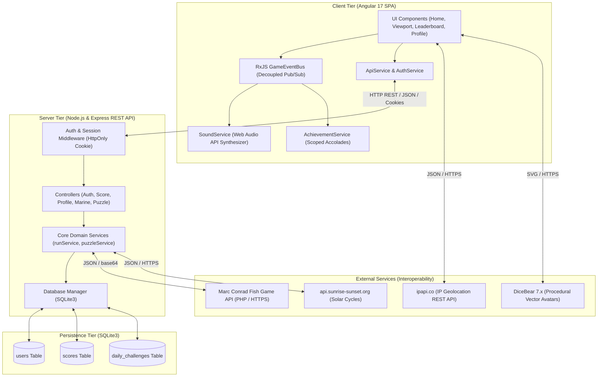

# CIS045-3 Distributed Service Architectures — Coursework 1
## Complete Viva & Presentation Master Study Note (Week 8 Sign-off)

---

## 1. System Architecture Overview

**Ocean Quest Chronicles** is a distributed web-based retro ocean exploration and cryptographic game built for **CIS045-3 Distributed Service Architectures** at the University of Bedfordshire. 

### High-Level Architecture Diagram



---

## 2. The 4 Academic Themes Explained in Depth

---

### Theme 1: Low Coupling & High Cohesion (Week 2)

#### What It Means in Simple Words
* **High Cohesion:** A class, component, or file does **one specific job and does it completely**. It does not mix responsibilities.
* **Low Coupling:** Subsystems are independent and communicate through thin, well-defined contracts. Changing or refactoring one module does not break another.

#### Evidence in the Codebase

1. **Strict 4-Tier Backend Separation:**
   * **Route Tier:** [scoreRoutes.js](file:///c:/Users/Vinuda/Downloads/OceanQuest_Chronicles_FULL/OceanQuest_Chronicles/backend/routes/scoreRoutes.js) — purely mounts endpoints (`GET /`, `POST /`) and attaches guards (`authMiddleware`). It contains **zero database queries**.
   * **Controller Tier:** [scoreController.js](file:///c:/Users/Vinuda/Downloads/OceanQuest_Chronicles_FULL/OceanQuest_Chronicles/backend/controllers/scoreController.js) — strictly unwraps HTTP payloads, handles session extraction, and returns JSON status codes (`200`, `201`, `400`).
   * **Domain Service Tier:** [runService.js](file:///c:/Users/Vinuda/Downloads/OceanQuest_Chronicles_FULL/OceanQuest_Chronicles/backend/services/runService.js) — contains **all game scoring logic and anti-cheat validation**. It has zero knowledge of Express, HTTP, or SQLite.
   * **Database Tier:** [db.js](file:///c:/Users/Vinuda/Downloads/OceanQuest_Chronicles_FULL/OceanQuest_Chronicles/backend/config/db.js) — manages connections, parameter binding, and table migrations.

2. **Isolated External Schema Translation:**
   * [puzzleService.js](file:///c:/Users/Vinuda/Downloads/OceanQuest_Chronicles_FULL/OceanQuest_Chronicles/backend/services/puzzleService.js) is the **single place** in the whole codebase that knows Dr. Marc Conrad’s PHP API format (`?out=json&base64=yes`). If the University changes its API field names from `question` to `puzzle_img`, only this single file needs updating.

3. **Client-Side Service Abstraction:**
   * Components like [leaderboard.component.ts](file:///c:/Users/Vinuda/Downloads/OceanQuest_Chronicles_FULL/OceanQuest_Chronicles/frontend/src/app/components/leaderboard/leaderboard.component.ts) never call `fetch()` or `HttpClient` directly; they call `this.apiService.getLeaderboard(limit, level, mode)`.

#### Exact Code Snippet to Show Tutor:
File: `backend/services/runService.js` (lines 36–54)
```javascript
// High Cohesion: Pure business logic — verifying dive time, clamping cheated scores, and computing points
exports.finish = (session, { depthReached, explorationScore, level }) => {
  const run = session.run;
  if (!run || run.finished) return null;
  const seconds = (Date.now() - run.startedAt) / 1000;
  
  // Anti-cheat verification: exploration capped per elapsed second
  const exploration = clamp(Number(explorationScore) || 0, 0, Math.floor(seconds * MAX_EXPLORATION_PER_SECOND) + 50);
  const parsedDepth = clamp(Math.floor(Number(depthReached) || 0), 0, MAX_DEPTH);
  
  run.finished = true;
  return {
    score: run.puzzleScore + Math.floor(exploration),
    depthReached: parsedDepth,
    chestsCollected: run.chests,
    level: level || 1
  };
};
```

---

### Theme 2: Event-Driven Architecture (Week 3)

#### What It Means in Simple Words
Instead of one giant function running in lockstep and calling every other function, the system uses a **Publish/Subscribe (Pub/Sub)** model. When something interesting happens in the game, the game engine **publishes an event**. Unrelated services **subscribe to the event bus** and react on their own terms.

#### Evidence in the Codebase

1. **Decoupled Game Event Bus:**
   * File: [event-bus.service.ts](file:///c:/Users/Vinuda/Downloads/OceanQuest_Chronicles_FULL/OceanQuest_Chronicles/frontend/src/app/services/event-bus.service.ts)
   * Built on an RxJS `Subject<GameEvent>` supporting strongly typed event payloads:
     ```typescript
     export type GameEventType = 
       | 'Swim' 
       | 'BubbleCollected' 
       | 'SharkBite' 
       | 'SwordSlash' 
       | 'ChestUnlocked' 
       | 'PowerupCollected';
     ```

2. **Publisher:**
   * File: [game-engine.service.ts](file:///c:/Users/Vinuda/Downloads/OceanQuest_Chronicles_FULL/OceanQuest_Chronicles/frontend/src/app/services/game-engine.service.ts)
   * The 60 FPS physics and collision loop detects interactions and emits events:
     ```typescript
     this.bus.emit({ type: 'BubbleCollected', score: this.state.score });
     this.bus.emit({ type: 'SharkBite', damage: 1, remainingLives: this.state.lives });
     ```

3. **Subscribers:**
   * [sound.service.ts](file:///c:/Users/Vinuda/Downloads/OceanQuest_Chronicles_FULL/OceanQuest_Chronicles/frontend/src/app/services/sound.service.ts): Listens for `'BubbleCollected'` or `'SharkBite'` to trigger synthetic audio frequencies.
   * [achievement.service.ts](file:///c:/Users/Vinuda/Downloads/OceanQuest_Chronicles_FULL/OceanQuest_Chronicles/frontend/src/app/services/achievement.service.ts): Listens for `'ChestUnlocked'` or `'PowerupCollected'` to unlock pilot medals.

#### Event Trigger Categorization:
* **User GUI Triggers:** Key presses (`ArrowUp`, `ArrowDown`, `Space`) and button clicks.
* **Continuous Engine Triggers:** `requestAnimationFrame` collision checks executed 60 times per second outside Angular zone (`runOutsideAngular`) for high performance.
* **Temporal / Timeout Triggers:** Sonar puzzle 60-second validity window, daily challenge 30-second penalty countdown.

#### Exact Code Snippet to Show Tutor:
File: `frontend/src/app/services/achievement.service.ts` (lines 72–85)
```typescript
// Event-Driven Subscriber: Reacts to engine events without coupling to the game loop
constructor(private bus: GameEventBus, private authService: AuthService) {
  this.bus.events$.subscribe((event) => this.onGameEvent(event));
}

private onGameEvent(event: GameEvent): void {
  if (event.type === 'PowerupCollected') {
    this.unlock('speed_demon');
  } else if (event.type === 'ChestUnlocked') {
    this.unlock('treasure_hunter');
  }
}
```

---

### Theme 3: Interoperability (Week 4)

#### What It Means in Simple Words
Interoperability is the capability of disparate software systems—written in different programming languages, hosted on different servers, and running under different architectures—to exchange data seamlessly via standardized protocols.

#### Evidence in the Codebase

1. **Heterogeneous Tech Stack Interoperability:**
   * **PHP (External Server):** Dr. Marc Conrad’s Fish Game API (`https://marcconrad.com/uob/fish/api.php`).
   * **Node.js / Express (Middle Tier):** Internal backend API acting as an authentication and verification proxy.
   * **TypeScript / Angular 17 (Presentation Tier):** Browser client rendering the UI.
   * **SQLite3 (Database Engine):** C-based embedded relational database.

2. **Security Proxy Architecture (Zero Solution Leakage):**
   * If the Angular client called Marc Conrad's API directly, a player could open the browser's **Network Tab** and inspect `data.fish` to cheat on every puzzle.
   * **The Interoperability Solution:**
     1. Express makes an HTTPS GET request to `marcconrad.com`.
     2. Express receives JSON with a base64 PNG data URI and an integer `fish` answer.
     3. Express stores `solution` inside the pilot's **encrypted server session**.
     4. Express strips the answer and sends **only the base64 image and shuffled multiple-choice buttons** to Angular.
     5. The student answers in Angular, and Express verifies the answer server-side.

3. **External Services Table:**
   | Service | Protocol | Payload Type | Purpose in Game |
   |---|---|---|---|
   | **UoB Fish Game API** | HTTPS GET | JSON & base64 PNG | Mystery chest cryptographic sonar puzzle |
   | **ipapi.co** | HTTPS GET | JSON | Pilot base station detection (e.g. Colombo, LK) |
   | **Sunrise-Sunset API** | HTTPS GET | JSON (UTC timestamp) | Real-world astronomical lighting cycles |
   | **DiceBear API** | HTTPS GET | SVG Vector | Procedural diver callsign avatars |

#### Exact Code Snippet to Show Tutor:
File: `backend/services/puzzleService.js` (lines 14–34)
```javascript
// Interoperability Bridge: Fetches PHP API data over HTTPS and translates into clean JSON
exports.fetchFishPuzzle = async () => {
  const url = process.env.FISH_API_URL || 'https://marcconrad.com/uob/fish/api.php?out=json&base64=yes';
  const res = await fetch(url);
  const text = await res.text();
  const data = JSON.parse(text);

  // Normalizes base64 PNG data URI and extracts integer answer
  return {
    imageUri: data.question.startsWith('data:') ? data.question : `data:image/png;base64,${data.question}`,
    solution: parseInt(data.fish, 10)
  };
};
```

---

### Theme 4: Virtual Identity & Privacy (Week 5)

#### What It Means in Simple Words
Virtual identity establishes who the user is in the system, how their credentials are authenticated, how their privacy is respected, and how their progress and reputation are protected against tampering.

#### Evidence in the Codebase

1. **Credential Security & Salted Passwords:**
   * Passwords are never saved in plaintext; [authController.js](file:///c:/Users/Vinuda/Downloads/OceanQuest_Chronicles_FULL/OceanQuest_Chronicles/backend/controllers/authController.js) hashes them with `bcrypt.hash(password, 10)` before insertion into SQLite.

2. **Server-Side Session Cookies (Anti-XSS & Anti-CSRF):**
   * Configured in [server.js](file:///c:/Users/Vinuda/Downloads/OceanQuest_Chronicles_FULL/OceanQuest_Chronicles/backend/server.js):
     * `httpOnly: true`: JavaScript cannot read or steal the cookie via XSS attacks.
     * `sameSite: 'lax'`: Protects against Cross-Site Request Forgery (CSRF).
     * `req.session.regenerate()`: Called upon login and signup to prevent **session fixation attacks**.

3. **Server-Verified Score Integrity:**
   * Scores are never trusted from the client. `runService` calculates points exclusively from server-verified puzzles (`POINTS_PER_CHEST = 250`) plus clamped physical exploration depth.

4. **Privacy-Preserving Geolocation:**
   * Connects to `ipapi.co` to show broad country/city base stations (e.g. *"Badulla, Sri Lanka 🇱🇰"*), preserving pilot privacy without querying precise GPS coordinates.

5. **Deterministic Procedural Diver Identity (DiceBear 7.x):**
   * File: [auth.service.ts](file:///c:/Users/Vinuda/Downloads/OceanQuest_Chronicles_FULL/OceanQuest_Chronicles/frontend/src/app/services/auth.service.ts)
   * The diver helmet is mathematically generated from `encodeURIComponent(callsign)`:
     ```typescript
     return `https://api.dicebear.com/7.x/bottts/svg?seed=${encodeURIComponent(name)}&backgroundColor=${bg}`;
     ```
   * Pilots retain a consistent, permanent facial identity across all leaderboard rows and profile dossiers without uploading personal photos.

#### Exact Code Snippet to Show Tutor:
File: `backend/middleware/authMiddleware.js` (lines 10–19)
```javascript
// Virtual Identity Guard: Enforces identity directly from server session, never trusting client headers
module.exports = (req, res, next) => {
  if (req.session && req.session.userId) {
    return next();
  }
  return res.status(401).json({
    message: 'Active naval session required. Please log in.'
  });
};
```

---

## 3. Notable Additional Features (For Top Marks)

1. **Dual-Mode Global Leaderboard:**
   * **Personal Best Mode:** Filters `WHERE (level >= 1 OR level IS NULL)` using `MAX(score) GROUP BY userId` to reward peak single-dive skill.
   * **Lifetime Career XP Mode:** Uses `SUM(score) GROUP BY userId` to accumulate every exploration dive and daily challenge bonus.
2. **Naval Military Ranks:**
   * Ranks dynamically calculate from career telemetry:
     * 👑 **Fleet Admiral** (1000+ PTS)
     * 🎖️ **Commander** (600–999 PTS)
     * ⚓ **Lieutenant** (300–599 PTS)
     * 🎗️ **Cadet** (0–299 PTS)
3. **Daily Sonar Cipher Challenge:**
   * Backed by SQLite table `daily_challenges (userId, challengeDate)` with a `UNIQUE(userId, challengeDate)` constraint so each pilot can decode today's challenge once for **+500 XP**.
4. **Web Audio API Real-Time Sound Synthesis:**
   * [sound.service.ts](file:///c:/Users/Vinuda/Downloads/OceanQuest_Chronicles_FULL/OceanQuest_Chronicles/frontend/src/app/services/sound.service.ts) creates vintage sub-bass sonar pings, bubble blips, and chest fanfares using pure programmatic oscillators (`AudioContext`), requiring zero external `.mp3` assets.
5. **Zero-Scroll Viewport Optimization:**
   * Compact, responsive UI where all cards (Leaderboard, Profile Dossier, Level Complete Modal, Game Over) fit inside `94vh` with full visibility and floating underwater bubble animations.

---

## 4. Viva Q&A Cheat Sheet (What Tutors Typically Ask)

### Q1: "Why did you use server-side sessions instead of JWT stored in localStorage?"
> **Answer:** *"JWTs stored in browser localStorage are vulnerable to Cross-Site Scripting (XSS) and cannot be easily revoked before they expire. Server-side session cookies with the `HttpOnly` and `SameSite` flags cannot be accessed by client scripts and allow the server to instantly invalidate the identity upon logout."*

### Q2: "What prevents a player from cheating and submitting 99,999 points?"
> **Answer:** *"The client never sends a final score number to the server. The client only submits elapsed exploration time and puzzle answers. The server's `runService.js` calculates the score by awarding 250 points only for puzzles verified server-side, and clamps exploration points to a strict human limit per second. Any forged score is rejected with a 409 status or clamped."*

### Q3: "How does your game demonstrate Event-Driven Architecture compared to traditional polling?"
> **Answer:** *"We use an RxJS `GameEventBus` implementing the observer pattern. The game engine emits events such as `BubbleCollected` or `SharkBite`. The `SoundService` and `AchievementService` subscribe asynchronously to this stream. They react to game changes without polling and without the game engine holding any direct reference to them."*

### Q4: "How does your application achieve Interoperability with Dr. Marc Conrad’s API?"
> **Answer:** *"Dr. Conrad’s API is a remote PHP web service that exposes data over HTTPS. Our Express server interoperates with it by issuing RESTful GET requests, parsing the returned JSON payload and base64 PNG data, storing the cryptographic answer in the session, and relaying the challenge to our Angular frontend."*

---

## 5. Quick Terminal Demo Commands (Keep Ready)

1. **Run Backend Test Suite (Automated Verification):**
   ```powershell
   cd OceanQuest_Chronicles\backend
   npm test
   ```
   *(Shows all 13 checks passing: cookies, sessions, Fish API proxy, verified scoring, anti-cheat clamping).*

2. **Start Backend Server:**
   ```powershell
   cd OceanQuest_Chronicles\backend
   npm start
   ```

3. **Run Frontend Application:**
   ```powershell
   cd OceanQuest_Chronicles\frontend
   npm start
   ```
   *(Access at `http://localhost:4200`)*
